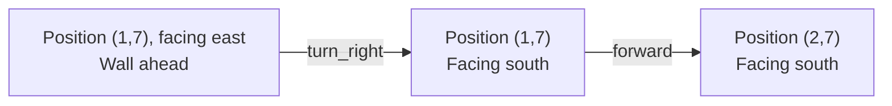
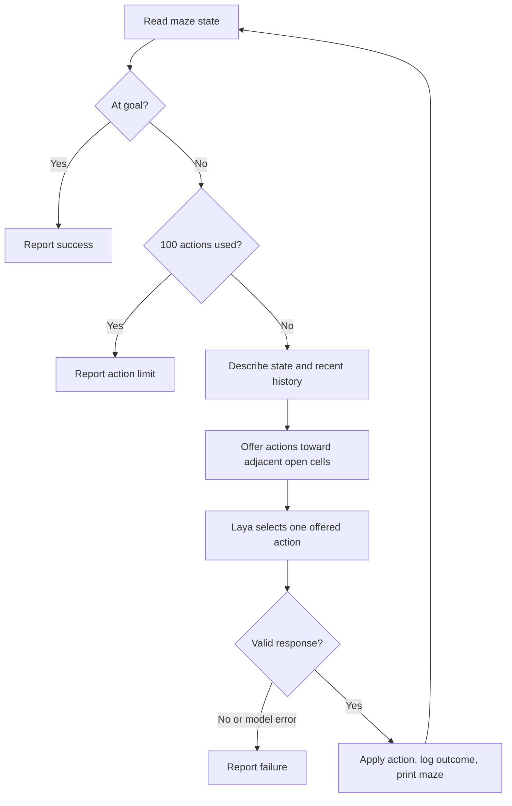

# LAB1: Laya decisions in a grid maze

## Goal

Build a Python program that uses Laya to guide a robot from the start cell to
the goal. This lab focuses on describing state, selecting actions, and evaluating
decisions. The supplied environment uses a known maze and exact robot position.
It requires no sensors, localization, graphics, or wheel physics.

The robot models differential-drive movement in discrete steps: it turns in
place and moves forward one cell. It cannot move sideways.

## Supplied infrastructure

`maze.py` provides a `Maze` class with one fixed, solvable maze:

```text
#########
#S......#
#.#####.#
#...#...#
###.#.#.#
#.....#G#
#########
```

`#` means wall; `.` means free space. `S` and `G` mark the start and goal in
this diagram. In the returned grid, those cells contain `.`; their coordinates
are returned separately.

Coordinates are **zero-based `(row, column)`**, with `(0, 0)` at the top left.
Rows increase downward; columns increase to the right. The start is `(1, 1)`,
facing east; the goal is `(5, 7)`.

| Method | Behavior |
| --- | --- |
| `Maze()` | Create an environment at its starting state. |
| `get_state()` | Return a fresh dictionary containing the full maze and current state. |
| `step(action)` | Apply one action; return `True` if applied, or `False` if forward movement is blocked. |
| `reset()` | Restore the start position and east-facing heading; return `None`. |

The state format is:

```python
{
    "grid": ["#########", "#.......#", ...],  # List of row strings
    "position": (1, 1),                       # (row, column)
    "heading": "east",                        # north/east/south/west
    "goal": (5, 7),
}
```

Each snapshot is independent of the environment. Editing a returned dictionary
or grid list does not change the maze. Call `get_state()` again after an action
to obtain the updated state.

| Action | Effect |
| --- | --- |
| `forward` | Move one cell in the current heading if the destination is free. |
| `turn_left` | Rotate 90 degrees counterclockwise without moving. |
| `turn_right` | Rotate 90 degrees clockwise without moving. |
| `turn_around` | Rotate 180 degrees without moving. |

Blocked moves preserve both position and heading. Unknown actions raise
`ValueError` and preserve state. Reaching the goal does not automatically stop
the environment: your program must detect completion.

## Try the module

Use Python 3.11 or newer for this uv project. The maze module itself needs only
the standard library.
From the repository root:

```bash
python3 LAB1/main.py
```

This loads the supplied maze and prints its grid with cyan `R` marking the robot's
current position and green `G` marking the goal, using ANSI terminal colors.
When the robot reaches the goal,
`R` takes precedence. These display markers do not change the `get_state()` grid.

To explore the state and movement interactively:

```bash
cd LAB1
python3
```

Then enter:

```python
from maze import Maze

maze = Maze()
print(maze.get_state())

applied = maze.step("forward")
print(applied)                       # True
print(maze.get_state()["position"])  # (1, 2)

maze.step("turn_left")               # Now facing north
print(maze.step("forward"))          # False: wall ahead

maze.reset()
print(maze.get_state()["heading"])   # east
```

`LAB1/student.py` supplies a reference implementation. Study it, run it, then
experiment with its state description and action criteria.

## Run the Laya solution

From the repository root:

```bash
uv sync
uv run LAB1/student.py
```

The first prediction downloads model weights. The program prints the initial
maze and the maze after each action, with `R` for the robot and `G` for the goal.
Colored Loguru messages on stderr record action number, pose, and whether a move
was applied or blocked. The final stdout line reports status, actions, and
blocked moves. Exit code is `0` only when the goal is reached; otherwise it is `1`.

### Understand the coordinates and turns

```text
       column increases east ->
       012345678
row 0  #########
    1  #R......#   R starts at (1,1), facing east ->
    2  #.#####.#
    3  #...#...#
    4  ###.#.#.#
    5  #.....#G#   G is at (5,7)
    6  #########
    |
    v row increases south
```

Robot-relative left and right depend on heading. Facing east, `turn_right`
changes heading to south; facing south, it changes heading to west. Turning
does not change position. Here is an illustrative decision sequence, not an
observed Laya prediction:



### Describe the state before asking for an action

`describe_state()` combines the full grid with explicit coordinates, heading,
goal, adjacent walls, and the last eight action outcomes. At the start, its
observation includes:

```text
Robot position: (1, 1); heading: east.
Goal position: (5, 7).
Adjacent cells: north: wall; east: free; south: free; west: wall
Recent outcomes (oldest first):
None yet.
```

Python computes these observations from the grid; it does not compute a route.
The goal is southeast of the start, but moving generally southeast is not
enough: walls can require a detour. Recent outcomes show when an action was
blocked or when the robot repeated a position and heading. This gives Laya
useful evidence, without guaranteeing that it will avoid loops.

### Ask a typed choice question

Laya selects a named option from criteria, rather than generating a free-form
navigation program. Its [official quickstart](https://github.com/NandhaKishorM/laya#quickstart)
uses `Router.predict(state_text, questions)` and returns the selected option
under `answers`. The reference program creates one router and reuses it.

This shortened example shows the request shape; `student.py` contains the full
criteria and response validation:

```python
from laya import Router
from student import build_questions, describe_state
from maze import Maze

router = Router()
maze = Maze()
state = maze.get_state()
state_text = describe_state(state, [])
result = router.predict(state_text, build_questions(state))
action = result["answers"]["action"]["choice"]
```

Run this snippet from `LAB1` with the project's virtual environment activated.
`QUESTIONS` defines the four supported actions. `build_questions()` offers a
subset for the current pose: forward only if the cell ahead is free, and turns
only if the resulting heading faces a free adjacent cell. At `(1,7)` facing
east, the options are `turn_right` and `turn_around`; `forward` and `turn_left`
are omitted because they point at walls.

The environment still permits turning toward a wall; filtering these turns is
a constraint of this reference policy. Laya chooses among the offered options.
Python does not compute a route or substitute an action for the model's choice.
Instructions also ask Laya to avoid repeated states, but this remains a model
decision rather than a guaranteed property.

### Execute one action, then observe again



`run()` validates that the response contains one of the currently offered actions before
calling `step()`. It reads a fresh snapshot after every action and adds the
outcome to bounded history. Blocked moves and turns count toward the 100-action
limit. Missing fields or choices outside the offered set end with `invalid_response`; model
exceptions end with `model_error`. There are no retries or replacement policies.
Reaching the goal on the last allowed action still counts as success.

### Evaluate the result

Inspect the final status and the action trace. `goal_reached` means the model's
choices reached the goal. `action_limit` means the experiment ended before
completion; look for repeated turns, revisits, and blocked moves. Change the
description or criteria and rerun to compare behavior, rather than embedding
the known successful route.

Unit tests use a fake router with predetermined responses to check the loop.
Passing those tests verifies the program's control flow, not Laya's navigation
ability. A real model run is reported separately below.

### Observed model run

Before adding action filtering, Laya **0.4.6** produced:

```text
Result: action_limit; actions: 100; blocked moves: 94
```

The robot moved east to `(1,7)`, then repeatedly selected `forward` while facing
the wall. It did not reach the goal. The loop correctly recorded blocked moves
and terminated at its limit. This is one observed run, not a guarantee about
other devices, checkpoints, or future versions. It demonstrates why this lab
asks you to measure model decisions and improve their input description.

After offering only actions toward adjacent open cells, the same command and
Laya version reached the goal:

```text
Result: goal_reached; actions: 17; blocked moves: 0
```

Filtering removes impossible forward moves and unhelpful turns toward walls.
It does not prevent every possible loop or guarantee that another model run
will reach the goal; the 100-action limit still applies.

## What you implement

1. **Laya setup and integration.** Run `uv sync` for the declared dependencies
   and consult the [Laya documentation](https://github.com/NandhaKishorM/laya).
   Model weights are downloaded at first inference, rather than stored here.
2. **State description.** Convert the maze, pose, and goal into clear text for
   the model. Explain the coordinate convention, wall symbols, and headings.
   You can derive nearby walls from the grid and include visit history.
3. **Action selection.** Ask Laya to select one of the four supported actions.
   Extract and validate its result before passing it to `step()`.
4. **Navigation loop.** Read state, select an action, apply it, and repeat.
   Stop when `state["position"] == state["goal"]`. Add a maximum action count
   so unsuccessful runs terminate. Count turns and blocked moves too.
5. **Failure handling and memory.** Handle model failures and invalid outputs;
   decide how to respond to blocked moves or repeated visits. The environment
   keeps pose, but it does not maintain your navigation history.
6. **Results.** Report whether the goal was reached, total actions, and blocked
   moves. Record enough of the state/action trace to explain an unsuccessful run.

Keep the environment rules in `maze.py` and your model calls and navigation
logic in your student program. This separates responsibilities and lets the
same maze run with different decision policies. There is no need for a class
hierarchy, interfaces, or additional frameworks for this lab.

## Expected outcome

Submit your student program and a short description of its input format,
decision logic, and observed results. The program should use Laya to select
actions, stop at the goal or action limit, and report failures clearly. Do not
hard-code the successful route or change the maze to make the run succeed.
Model success is something to measure, not an assumption.

## Check the supplied environment

From the repository root, run:

```bash
uv run python -m unittest discover -s tests/LAB1 -v
```

The tests verify movement, wall rejection, turning, invalid actions, snapshot
isolation, goal reachability, and reset. Reference-solution tests also check
goal completion, blocked moves, observation updates, bounded history, action
limits, action filtering at the wall corner, invalid responses, and model exceptions
using a fake router. A simulated rejected move checks blocked-move handling
even though filtering excludes moves into known walls. These tests do
not evaluate real model accuracy.
